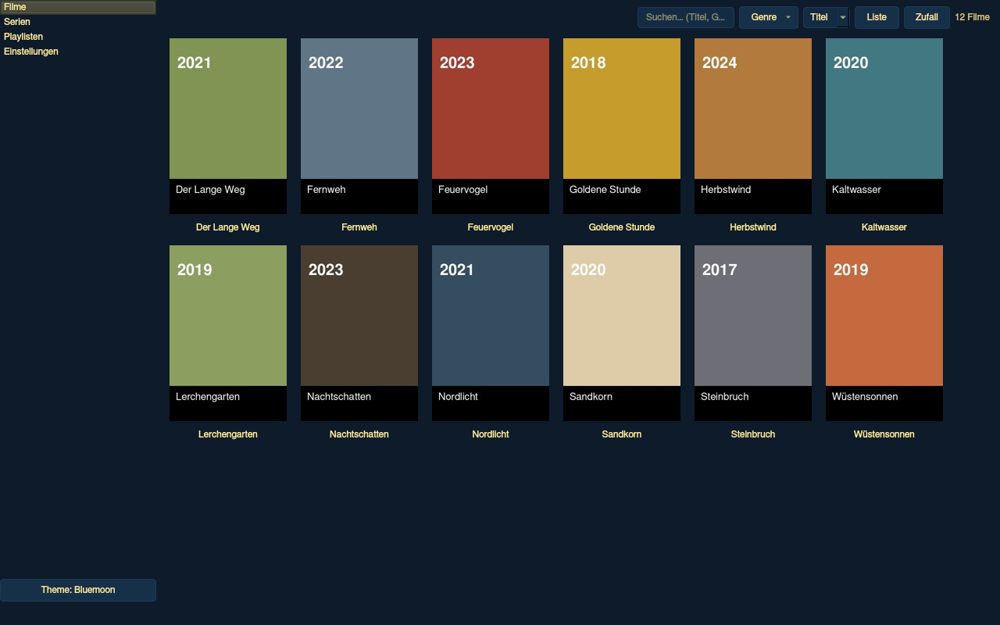
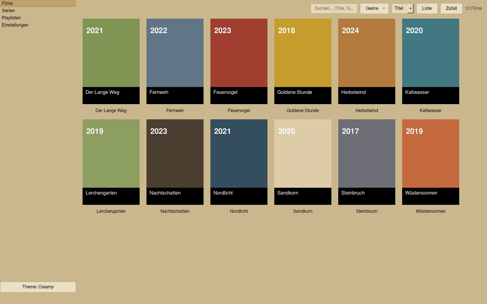

<div align="center">


# MediC

**Mediathek-GUI für Windows &amp; Linux** — Posterwand, NFO-Unterstützung,
Playlisten und Wiedergabe über externe Player wie VLC oder mpv.

**[⬇ Download (aktuelle Version)](https://github.com/cvinz78/MediC/releases/latest)** · [Lizenz: GPL-3.0](LICENSE) · [Manual (English)](Manual.md) · **[🇬🇧 English](#medic-english)**

</div>

---

**MediC** (von *MediaCenter*) liest lokale Medienordner ein, zeigt Filme und
Serien als Posterwand und übergibt die Wiedergabe an den externen Player deiner Wahl
(Standard: VLC). Vorhandene Metadaten- und Bilddateien — `movie.nfo`, `tvshow.nfo`,
Poster, Fanart, Trailer, Untertitel — werden ohne Konvertierung genutzt. Es werden **niemals Dateien
deiner Mediathek verändert oder gelöscht**, die App schreibt ausschließlich in ihren
eigenen Datenordner.

---

## Screenshots — die drei Skins

| Darkskin (Standard) | Bluemoon | Creamy |
|---|---|---|
|  |  |  |

Der Skin lässt sich jederzeit umschalten — per **Theme-Button unten links** (klickt durch
alle drei) oder unter **Einstellungen → Ansicht**. Der Wechsel wirkt sofort, ohne Neustart.
*(Screenshots zeigen eine Beispieldatenbank.)*

---

## Funktionen

### Bibliotheken & Scan
- **Mehrere Bibliotheken** konfigurierbar (Name, Typ, Pfad) — beliebig viele Unterordner rekursiv
- **Eigene Kategorien** neben „Filme“ und „Serien“ (z. B. „Doku“, „Comedy“) — jede Kategorie bekommt einen eigenen Eintrag in der Navigation
- **Auto-Klassifikation**: Ordner mit Serienstruktur (`tvshow.nfo`, `SxxEyy`) landen automatisch in der Serien-Ansicht — auch innerhalb von Film-/Kategorie-Bibliotheken
- **Inkrementeller Scan**: unveränderte Einträge (mtime + Pfad) werden nicht neu eingelesen
- Scan läuft im **Hintergrund-Thread** mit Fortschritt in Prozent, aktueller Datei und **Abbrechen-Button**
- **Netzwerk-Mounts** (NFS/SMB): langsame Scans sind kein Problem, IO-Fehler (Mount weg) werden als Warnung behandelt statt den Scan abzubrechen
- Verschwundene Dateien räumt der Scan aus der Mediathek auf — **nur aus der Datenbank, nie von der Festplatte**

### NFO-Metadaten & Datei-Erkennung
- NFO-Parsing: `movie.nfo`, `tvshow.nfo`, Episoden-NFOs — inkl. UTF-8 mit BOM, Fallback latin-1, XML ab beliebiger Zeile, doppelte `<movie>`-Blöcke, modernes `<ratings>`-Format; unbekannte Tags werden ignoriert
- Erkannt werden: Titel, Sortier-Titel, Plot, Jahr, Bewertung, Laufzeit, Genres, Studio, Regisseur, Darsteller, Poster, Fanart, Trailer, Staffel/Episode/Ausstrahlungsdatum
- Poster/Fanart/Banner/Staffel-Poster/Trailer/Untertitel nach dem gängigen NFO-Schema (Tabelle unten)

### Posterwand & Ansichten
- **Klick auf ein Poster = Film startet** im Standard-Player
- **Rechtsklick = Kontextmenü**: Abspielen, Trailer abspielen, Details/Medieninfos, Zur Playlist hinzufügen, Ordner öffnen, Metadaten neu einlesen, Aus Bibliothek entfernen
- **Posterwand ↔ Liste** umschaltbar (Filme, Serien und eigene Kategorien; Serien-Liste mit Titel/Jahr/Bewertung)
- **4 Postergrößen** (Klein/Mittel/Groß/Sehr groß), Titel unter dem Poster an/aus
- **Live-Suche** über Titel, Genre und Jahr — inkl. Jahresbereichen (`1977-2005`, `1977-`, `-2005`)
- **Genre-Filter mit Zählern** — getrennt je Ansicht (Filme-Seite zeigt nur Film-Genres usw.), als Klick-Menü mit **gleicher Bedienung unter Windows & Linux**
- **Sortierung** nach Titel oder Jahr
- **„Zufall“-Button**: spielt einen zufälligen Film bzw. eine zufällige Episode — bei aktivem Filter aus den gefilterten Einträgen, in der Staffel-/Episoden-Ansicht aus der aktuell geöffneten Serie/Staffel

### Serien-Ansicht (3 Ebenen)
- Ebene 1: Posterwand aller Serien → Ebene 2: Staffeln + Serieninfos (Fanart-Hintergrund) → Ebene 3: Episodenliste mit Thumbnails
- **Breadcrumb-Navigation** (Serien › Show › Staffel) + **Zurück/Vor-Knöpfe** wie im Browser — `Esc` geht über die History mehrstufig zurück
- Ganze Serien oder einzelne Staffeln abspielen (temporäre M3U8 an den Player) oder in Playlisten aufnehmen

### Detail-Dialog (Medieninfos)
- Großes Poster, abgedunkeltes Fanart als Hintergrund, Sternebewertung
- Jahr, Bewertung, Laufzeit, Genres, Studio, Regisseur, Darsteller, vollständiger Plot
- Abschnitt „Dateien“: Videopfad, gefundene Untertitel (**anklickbar** → Wiedergabe mit diesem Untertitel), Trailer-Quelle

### Wiedergabe & Player
- **Standard-Player: VLC** — automatische Erkennung unter Linux (`$PATH` → `/usr/bin` → `/usr/local/bin` → `/snap/bin` → Flatpak) und Windows (`$PATH` → Registry → Programmordner)
- Weitere Player frei konfigurierbar (mpv, SMPlayer, Celluloid …) mit Argument-Vorlagen `{file}` und `{subtitle}`
- **Vollbild** optional (Einstellung, Standard: aus)
- **Untertitel** werden per `--sub-file` an VLC/mpv übergeben
- **Trailer**: lokale Trailerdatei wird bevorzugt; YouTube-URL öffnet den Browser (oder VLC, einstellbar)
- Player nicht gefunden → Dialog mit Pfadeingabe statt stillem Abbruch
- Der Player startet als eigener Prozess — die App bleibt bedienbar

### Playlisten
- Eigene Ansicht: Playlisten anlegen/umbenennen/löschen, Einträge mit **↑/↓** sortieren
- Einträge: **Filme, Episoden, ganze Serien und Staffeln** (Duplikate erlaubt)
- **Export als M3U8 / M3U / XSPF**, Import von M3U/M3U8
- Wiedergabe über temporäre M3U8 an den Player

### Tastenkürzel
Alle Hauptaktionen sind **editierbar** (Einstellungen → Tastenkürzel, mit Kollisionsprüfung
und „Alle zurücksetzen“). Standard-Belegung:

| Aktion | Taste |
|---|---|
| Abspielen | `Enter` |
| Details/Medieninfos | `i` |
| Trailer abspielen | `t` |
| Suche fokussieren | `Strg+F` |
| Bibliotheken scannen | `F5` |
| Zurück (Dialog/Ebene) | `Esc` |
| Eintrag aus Playlist entfernen | `Entf` |

### Thumbnails ohne NFO/Poster
- Ohne NFO/Poster dient ein **Frame aus dem Video selbst** als Poster (braucht `ffmpeg`, wird automatisch erkannt — optional)
- Der **Dateiname wird zum Titel** (inkl. Jahreszahl-Erkennung)
- Ohne ffmpeg: gerenderter Platzhalter im Skin-Farbdesign
- Thumbnail-Cache im Datenordner — auch sehr große Bibliotheken (1000+) bleiben flott, Ansicht lädt lazy

### Weitere Details
- **3 Skins**: Darkskin, Bluemoon, Creamy (siehe Screenshots oben)
- **Sprache Deutsch/English** (Einstellungen → Ansicht; Standard Deutsch, Übernahme nach Neustart)
- **Fenstergröße/Position/Maximierung wird gemerkt**
- „Ordner öffnen“ via `xdg-open` (Linux) bzw. Windows-Explorer
- **Scrollbar-Farben je Skin**: Griff immer sichtbar in der Textfarbe des Skins
- Fehlende Videodateien werden angezeigt/markiert; Berechtigungsfehler (NTFS/externe Platten) brechen den Scan nie ab
- Große/extreme Bilddateien werden beim Rendern runterskaliert, abgeschnittene Bilder soweit möglich angezeigt

---

## Download & Installation

Fertige Builds gibt es in den
**[Releases](https://github.com/cvinz78/MediC/releases/latest)**:

| Datei | Plattform | Was es ist |
|---|---|---|
| `MediC-windows-x64.exe` | Windows 10/11 (x64) | **Installer — enthält beide Varianten in einer Datei:** beim Start wählt man **„Installieren“** (Programmordner, Startmenü-Verknüpfung, Eintrag unter „Programme und Features“ mit Deinstallation) oder **„Portable entpacken“** (Programmordner ohne Verknüpfungen/Registry — ideal z. B. für den USB-Stick). Die App-EXE heißt danach `MediaCenterx64.exe` |
| `MediC-linux-x64` | Linux (x64) | Eine einzelne ausführbare Datei — kein Python/pip nötig, nur einen Desktop mit VLC/mpv |
| `MediC-windows-win7-x64.exe` | Windows 7 SP1/8.1 | Einzelne EXE für ältere Windows-Systeme (PyQt5/Qt 5.15) — OneFile, kein `_internal`-Ordner nötig |

> **Windows ohne Installation:** Wer nichts installieren möchte, führt die
> `MediC-windows-x64.exe` aus und wählt **„Portable entpacken“** — der Installer
> kopiert dann nur den Programmordner in ein eigenes Verzeichnis der eigenen Wahl.
> Gestartet wird über die `MediaCenterx64.exe` in diesem Ordner; deinstallieren
> = Ordner löschen.

**SHA-256 (Version 2.7):**

```
89631b98817b81f06844071a572dfa606860daf4e57586da33a3499bfbdee34b  MediC-windows-x64.exe
6bf4809a84c2a5e57120112a9cca3a853af3aa8f48d539e6c8cd50bf11a94f31  MediC-linux-x64
3ade745bd0b7a48e5a248a72a4bad389f7af2631595bb6c6ede7ad64f45fe226  MediC-windows-win7-x64.exe
```

**Hinweise:**
- **Windows**: Da die EXE unsigniert ist, meldet SmartScreen beim ersten Start „Weitere
  Informationen → Trotzdem ausführen“ — das ist bei selbst gebauten PyInstaller-EXEs normal.
- **Linux**: `chmod +x MediC-linux-x64` und starten. Die Anwendung entpackt sich **einmalig**
  nach `/tmp/MediaCenter/<Version>` (Smart-Cache) und startet danach sofort von dort; nichts
  wird beim Beenden gelöscht, neu entpackt wird nur bei geleertem Ordner oder älterer Version.
  Auch aus einem Terminal gestartet, wird der Prompt sofort zurückgegeben — die App läuft
  abgekoppelt (keine Logzeilen im Terminal), das Protokoll steht in `~/.medi/logs/mediacenter.log`.
- **Windows 7 SP1/8.1**: Qt 6 läuft dort nicht — dafür gibt es die separate
  `MediC-windows-win7-x64.exe` (PyQt5/Qt 5.15, mit Python 3.8.10 gebaut). Einfach starten,
  keine Installation.

---

## Selbst bauen

Der komplette Quellcode der App liegt im Repo — die Anwendung ist bewusst **eine einzige
Python-Datei**. Zum Bauen aller drei Varianten ist genau dieses Set nötig:

| Datei | Zweck |
|---|---|
| `mediacenter.py` | die komplette App als Einzeldatei (Quelle für Windows; läuft auch direkt per `python mediacenter.py`) |
| `installer.py` | Windows-Installer (bietet „Installieren“ und „Portable entpacken“) |
| `build_windows.bat` | Komplett-Build Windows 10/11-Installer |
| `build_windows_win7.bat` | Build für Windows 7 SP1/8.1 (PyQt5) |
| `build_linux.bat` | Build NUR die Linux-Variante (braucht Docker, läuft auch unter Windows) |
| `build_all.bat` | baut alle drei Varianten nacheinander + Gesamt-`sha.txt` |
| `requirements.txt` | Laufzeit-Abhängigkeiten (PySide6, Pillow) |
| `icon/mediacenter.png` + `icon/mediacenter.ico` | App-Icon (Bau + Laufzeit) |
| `linux-version/mediacenter.py` | Linux-Variante des Quellcodes (plattformspezifische Anpassungen) |
| `linux-version/launcher_stub.py` | Smart-Cache-Launcher (entpackt einmalig nach `/tmp/MediaCenter/<Version>`) |
| `linux-version/build_linux_docker.sh` | Build-Skript für den Docker-Container |
| `build_app.sh` | Build-Skript für Linux (Docker mit Fallback auf lokales venv) |
| `scripts/make_ico.py` | erzeugt die `.ico` aus dem PNG |
| `scripts/win7_version.txt` | Versionsressource für die Win7-EXE |
| `scripts/write_sha.py` | schreibt `dist/sha.txt` + `linux-version/sha.txt` (SHA-256, vollständig) |

| Ziel | Befehl | Ergebnis | Umgebung |
|---|---|---|---|
| Windows 10/11 | `build_windows.bat` | `dist\mediacenter-installer.exe` | Windows, Python 3.10+ |
| Windows 7 SP1/8.1 | `build_windows_win7.bat` | `dist\MediaCenter.exe` | Windows, Python 3.8.10 |
| Linux | `./build_app.sh` (alternativ unter Windows: `build_linux.bat`) | `dist/MediaCenter` | Linux, Docker (Fallback: lokales venv) |
| Alle drei | `build_all.bat` | alle drei Artefakte + `dist\sha.txt` | Windows + Docker |

`build_app.sh` nutzt automatisch Docker (`python:3.12-slim`), damit das Ergebnis auf
gängigen Distributionen läuft — ohne Docker fällt es auf ein lokales venv zurück.
Wer es ohne Skript mag, kann den Container auch direkt füttern:
`docker run --rm -v <repo>/linux-version:/app:ro -v <repo>/icon:/icon:ro -v <repo>/dist:/out python:3.12-slim bash /app/build_linux_docker.sh`.

Die `.bat`-Skripte legen ihre venv selbst an und installieren alle Abhängigkeiten
(PySide6/PyQt5, Pillow, PyInstaller). Der Linux-Build läuft bewusst im Container
(`python:3.12-slim`), damit das Ergebnis auf gängigen Distributionen läuft — PyInstaller
kann nicht kreuzkompilieren, deshalb baut man die Windows-EXE unter Windows und das
Linux-ELF unter Linux/Docker. Nach dem Bau schreibt
`python3 scripts/write_sha.py` die `sha.txt` mit allen Hashes.

### Direkt aus dem Quellcode starten (ohne Bauen)

```bash
pip install -r requirements.txt     # PySide6, Pillow
python3 mediacenter.py              # unter Windows: python mediacenter.py
```

Braucht Python 3.10+ und einen installierten Player (VLC empfohlen); optional `ffmpeg`
für Video-Thumbnails. Unter minimalen Linux-Systemen zusätzlich
`libgl1 libegl1 libxkbcommon0 libglib2.0-0 libdbus-1-3 libfontconfig1`.

---

## Erste Schritte

1. Starten → **Einstellungen → Bibliotheken → Hinzufügen**: Ordner wählen (z. B. `~/Filme`,
   `/mnt/nas/Serien`), Name und Typ setzen (Filme/Serien/**eigene Kategorie**).
2. Der Scan läuft im Hintergrund (Fortschritt + Abbrechen) — danach erscheint die **Posterwand**.
3. **Klick** = Abspielen, **Rechtsklick** = Kontextmenü, **F5** = neu scannen.
4. Ohne NFO/Poster zeigt MediC automatisch Video-Frame-Thumbnails (mit ffmpeg) und
   Dateinamen-Titel — jede erkannte Videodatei erscheint in der Ansicht.

---

## Netzwerk-Freigaben: bewusst nur lokale Bibliotheken

MediC unterstützt **bewusst keine Netzwerkprotokolle** (kein SMB, NFS, DLNA/UPnP —
weder beim Scannen noch bei der Wiedergabe). Grund: Eine Mediathek-GUI, die selbst
über das Netzwerk liest und abspielt, müsste verlangen, dass auch der externe
Mediaplayer (VLC, mpv …) dasselbe Protokoll beherrscht — das macht die App vom
Player abhängig und die Fehlersuche unzuverlässig. Deshalb arbeitet MediC
ausschließlich mit **lokalen Ordnerpfaden**.

**Netzwerkquellen gehen trotzdem** — über das Betriebssystem: Die Freigabe wird
einmalig in Windows bzw. Linux **eingebunden (gemountet)**, und der eingebundene
Ordner wird ganz normal als Bibliothek angegeben:

| Plattform | Freigabe einbinden | Beispiel-Pfad für die Bibliothek |
|---|---|---|
| Windows | Explorer → „Netzlaufwerk verbinden“ (oder `net use Z: \\NAS\Filme /persistent:yes`) | `Z:\Filme` |
| Linux | `mount` von SMB/NFS, z. B. `sudo mount -t cifs //NAS/Filme /mnt/filme` (oder fstab/autofs) | `/mnt/filme` |

Für MediC ist ein eingebundener Netzwerk-Mount ein ganz normaler lokaler Ordner:
Der Scan liest die Dateien über das Dateisystem, und die Wiedergabe startet den
Player mit dem Pfad — **die Netzwerktechnik übernimmt das Betriebssystem bzw. der
Player, nicht MediC**. Scans über langsame Mounts (NFS/SMB) bleiben dank
Fortschrittsanzeige und abbrechbar bedienbar; IO-Fehler (Mount nicht erreichbar)
brechen den Scan nie ab, sondern werden als Warnung behandelt.

---

## Erkennungsregeln

| Typ | Gesucht wird (Reihenfolge = Priorität) |
|---|---|
| Video | `.mkv .mp4 .avi .m2ts .iso .wmv .mov .webm .ts .mpg .mpeg .flv` u. a. (Groß/Klein egal) |
| Film-NFO | `movie.nfo`, `<videoname>.nfo` im selben Ordner |
| Serien-NFO | `tvshow.nfo` im Serienordner; Episoden: `s01e02.nfo`/`<name>.nfo` |
| Poster | `poster.jpg` › `folder.jpg` › `cover.jpg` › `<name>.jpg` › `<ordnername>.jpg` |
| Staffel-Poster | `season01-poster.jpg`, `Season 01/poster.jpg`, `staffel1-poster.*` … |
| Fanart/Banner | `fanart.jpg`, `banner.jpg` |
| Trailer | `trailer.mp4/mkv/mov` › `<name>-trailer.*` › Ordner `trailer(s)/` › `<trailer>`-URL aus dem NFO |
| Untertitel | `<name>.srt/.ass/.sub/.vtt` (auch im Ordner `subs/`) |
| Episoden | `Serie/Season 01/S01E02.mkv` (auch `1x02`, Fallback: Reihenfolge) |

---

## Datenordner

Alle Einstellungen, die Datenbank und Logs liegen außerhalb der Mediathek:

| Plattform | Ordner |
|---|---|
| Linux | `~/.medi/` (`config/settings.json`, `data/library.db`, `data/cache/`, `logs/`) |
| Windows | `%USERPROFILE%\.medi\` |

Mit der Umgebungsvariable `MEDIACENTER_DATA_DIR` lässt sich der Ordner beliebig verlagern
(z. B. portabel auf dem Medienlaufwerk). Log bei Problemen:
`~/.medi/logs/mediacenter.log` bzw. `%USERPROFILE%\.medi\logs\mediacenter.log`.

---

## Lizenz

Copyright © 2026 cvinz78

Dieses Programm ist freie Software: Sie können es unter den Bedingungen der
**GNU General Public License, Version 3** weitergeben und/oder modifizieren —
veröffentlicht von der Free Software Foundation. Details siehe [LICENSE](LICENSE).

Dieses Programm wird in der Hoffnung verbreitet, dass es nützlich ist, aber **ohne
jede Garantie** — auch ohne implizite Garantie für Marktgängigkeit oder Eignung für
einen bestimmten Zweck. Siehe die GNU GPL Version 3 für Einzelheiten.

---

<a id="medic-english"></a>

# MediC (English)

**Media library GUI for Windows &amp; Linux** — poster wall, NFO support,
playlists and playback through external players such as VLC or mpv.

**[⬇ Download (latest version)](https://github.com/cvinz78/MediC/releases/latest)** · [License: GPL-3.0](LICENSE) · [Manual](Manual.md) · **[🇩🇪 Deutsch](#medic)**

---

**MediC** (as in *MediaCenter*) scans local media folders, shows movies and
TV shows as a poster wall and hands playback to the external player of your
choice (default: VLC). Existing metadata and image files — `movie.nfo`,
`tvshow.nfo`, posters, fanart, trailers, subtitles — are used without any
conversion. MediC **never modifies or deletes any files in your media
library**; the app writes exclusively to its own data folder.

---

## Features

### Libraries & scanning
- **Multiple libraries** configurable (name, type, path) — any number of subfolders, recursively
- **Custom categories** next to "Movies" and "TV Shows" (e.g. "Documentary", "Comedy") — each category gets its own entry in the navigation
- **Auto-classification**: folders with a show structure (`tvshow.nfo`, `SxxEyy`) automatically land in the TV view — even inside movie/category libraries
- **Incremental scan**: unchanged entries (mtime + path) are not re-parsed
- Scanning runs in a **background thread** with progress in percent, current file and a **cancel button**
- **Network mounts** (NFS/SMB): slow scans are no problem; I/O errors (mount gone) are treated as a warning instead of aborting the scan
- Missing files are cleaned up by the scan — **from the database only, never from disk**

### NFO metadata & file detection
- NFO parsing: `movie.nfo`, `tvshow.nfo`, episode NFOs — including UTF-8 with BOM, latin-1 fallback, XML starting at any line, duplicate `<movie>` blocks, modern `<ratings>` format; unknown tags are ignored
- Detected: title, sort title, plot, year, rating, runtime, genres, studio, director, actors, poster, fanart, trailer, season/episode/airdate
- Poster/fanart/banner/season poster/trailer/subtitles follow the common NFO scheme (table below)

### Poster wall & views
- **Click a poster = the movie starts** in the default player
- **Right-click = context menu**: play, play trailer, details/media info, add to playlist, open folder, re-read metadata, remove from library
- **Poster wall ↔ list** toggle (movies, TV shows and custom categories; TV list with title/year/rating)
- **4 poster sizes** (small/medium/large/very large), title under the poster on/off
- **Live search** across title, genre and year — including year ranges (`1977-2005`, `1977-`, `-2005`)
- **Genre filter with counters** — separate per view (the movies page only shows movie genres, etc.), as a click menu with **identical behaviour on Windows & Linux**
- **Sorting** by title or year
- **"Random" button**: plays a random movie or a random episode — with an active filter from the filtered entries; in the season/episode view from the currently opened show/season

### TV view (3 levels)
- Level 1: poster wall of all shows → level 2: seasons + show info (fanart background) → level 3: episode list with thumbnails
- **Breadcrumb navigation** (Shows › Show › Season) plus **back/forward buttons** like in a browser — `Esc` steps back through the history
- Play entire shows or individual seasons (temporary M3U8 handed to the player) or add them to playlists

### Detail dialog (media info)
- Large poster, dimmed fanart as background, star rating
- Year, rating, runtime, genres, studio, director, actors, full plot
- "Files" section: video path, detected subtitles (**clickable** → playback with that subtitle), trailer source

### Playback & players
- **Default player: VLC** — automatic detection on Linux (`$PATH` → `/usr/bin` → `/usr/local/bin` → `/snap/bin` → Flatpak) and Windows (`$PATH` → Registry → program folders)
- Additional players freely configurable (mpv, SMPlayer, Celluloid …) with the argument templates `{file}` and `{subtitle}`
- **Fullscreen** optional (setting, default: off)
- **Subtitles** are passed to VLC/mpv via `--sub-file`
- **Trailers**: a local trailer file takes precedence; a YouTube URL opens in the browser (or VLC, configurable)
- Player not found → dialog with a path input instead of a silent failure
- The player starts as its own process — the app stays responsive

### Playlists
- Dedicated view: create/rename/delete playlists, reorder entries with **↑/↓**
- Entries: **movies, episodes, entire shows and seasons** (duplicates allowed)
- **Export as M3U8 / M3U / XSPF**, import of M3U/M3U8
- Playback via a temporary M3U8 handed to the player

### Keyboard shortcuts
All main actions are **editable** (Settings → Shortcuts, with collision detection
and "Reset all"). Default assignments:

| Action | Key |
|---|---|
| Play | `Enter` |
| Details/media info | `i` |
| Play trailer | `t` |
| Focus search | `Ctrl+F` |
| Scan libraries | `F5` |
| Back (dialog/level) | `Esc` |
| Remove entry from playlist | `Del` |

### Thumbnails without NFO/poster
- Without NFO/poster, a **frame from the video itself** serves as the poster (requires `ffmpeg`, detected automatically — optional)
- The **file name becomes the title** (including year detection)
- Without ffmpeg: a rendered placeholder in the skin's colour scheme
- Thumbnail cache in the data folder — even very large libraries (1000+) stay fast, the view loads lazily

### More details
- **3 skins**: Darkskin, Bluemoon, Creamy (see the screenshots at the top of this page) — switchable at any time via the **theme button at the bottom left** (cycles through all three) or under **Settings → View**, effective immediately
- **Language German/English** (Settings → View; default German, applied after a restart)
- **Window size/position/maximized state is remembered**
- "Open folder" via `xdg-open` (Linux) or Windows Explorer
- **Scrollbar colours per skin**: the handle is always visible in the skin's text colour
- Missing video files are shown/flagged; permission errors (NTFS/external drives) never abort the scan
- Large/oversized image files are downscaled for rendering; truncated images are displayed as far as possible

---

## Download & installation

Ready-made builds are available in the
**[Releases](https://github.com/cvinz78/MediC/releases/latest)**:

| File | Platform | What it is |
|---|---|---|
| `MediC-windows-x64.exe` | Windows 10/11 (x64) | **Installer — contains both variants in one file:** at launch you choose **"Install"** (program folder, Start-menu shortcut, entry under "Apps & features" with an uninstaller) or **"Extract portable"** (program folder without shortcuts/registry — ideal e.g. for a USB stick). The app executable is then called `MediaCenterx64.exe` |
| `MediC-linux-x64` | Linux (x64) | A single executable file — no Python/pip needed, just a desktop with VLC/mpv |
| `MediC-windows-win7-x64.exe` | Windows 7 SP1/8.1 | Single EXE for older Windows systems (PyQt5/Qt 5.15) — OneFile, no `_internal` folder required |

> **Windows without installation:** If you don't want to install anything, run the
> `MediC-windows-x64.exe` and choose **"Extract portable"** — the installer then
> copies just the program folder to a directory of your choice. Launch it via the
> `MediaCenterx64.exe` in that folder; uninstalling = deleting the folder.

**SHA-256 (version 2.7):**

```
89631b98817b81f06844071a572dfa606860daf4e57586da33a3499bfbdee34b  MediC-windows-x64.exe
6bf4809a84c2a5e57120112a9cca3a853af3aa8f48d539e6c8cd50bf11a94f31  MediC-linux-x64
3ade745bd0b7a48e5a248a72a4bad389f7af2631595bb6c6ede7ad64f45fe226  MediC-windows-win7-x64.exe
```

**Notes:**
- **Windows**: the EXE is unsigned, so SmartScreen shows "More info → Run anyway" on
  first launch — that's normal for self-built PyInstaller EXEs.
- **Linux**: `chmod +x MediC-linux-x64` and run it. The application extracts
  **once** to `/tmp/MediaCenter/<version>` (smart cache) and then starts
  immediately from there; nothing is deleted on exit, re-extraction only happens
  when the folder was emptied or an older version is present. When launched from a
  terminal, the prompt returns immediately — the app runs detached (no log lines in
  the terminal); the log lives in `~/.medi/logs/mediacenter.log`.
- **Windows 7 SP1/8.1**: Qt 6 doesn't run there — that's what the separate
  `MediC-windows-win7-x64.exe` (PyQt5/Qt 5.15, built with Python 3.8.10) is for.
  Just run it, no installation.

---

## Build it yourself

The complete source code of the app is in this repository — the application is
deliberately **a single Python file**. Building all three variants needs exactly
this set:

| File | Purpose |
|---|---|
| `mediacenter.py` | the complete app as a single file (source for Windows; also runs directly via `python mediacenter.py`) |
| `installer.py` | Windows installer (offers "Install" and "Extract portable") |
| `build_windows.bat` | complete build of the Windows 10/11 installer |
| `build_windows_win7.bat` | build for Windows 7 SP1/8.1 (PyQt5) |
| `build_linux.bat` | builds ONLY the Linux variant (needs Docker, also runs on Windows) |
| `build_all.bat` | builds all three variants in sequence + combined `sha.txt` |
| `requirements.txt` | runtime dependencies (PySide6, Pillow) |
| `icon/mediacenter.png` + `icon/mediacenter.ico` | app icon (build + runtime) |
| `linux-version/mediacenter.py` | Linux variant of the source code (platform-specific adjustments) |
| `linux-version/launcher_stub.py` | smart-cache launcher (extracts once to `/tmp/MediaCenter/<version>`) |
| `linux-version/build_linux_docker.sh` | build script for the Docker container |
| `build_app.sh` | build script for Linux (Docker with local-venv fallback) |
| `scripts/make_ico.py` | generates the `.ico` from the PNG |
| `scripts/win7_version.txt` | version resource for the Win7 EXE |
| `scripts/write_sha.py` | writes `dist/sha.txt` + `linux-version/sha.txt` (SHA-256, full) |

| Target | Command | Result | Environment |
|---|---|---|---|
| Windows 10/11 | `build_windows.bat` | `dist\mediacenter-installer.exe` | Windows, Python 3.10+ |
| Windows 7 SP1/8.1 | `build_windows_win7.bat` | `dist\MediaCenter.exe` | Windows, Python 3.8.10 |
| Linux | `./build_app.sh` (alternatively on Windows: `build_linux.bat`) | `dist/MediaCenter` | Linux, Docker (fallback: local venv) |
| All three | `build_all.bat` | all three artifacts + `dist\sha.txt` | Windows + Docker |

`build_app.sh` automatically uses Docker (`python:3.12-slim`) so the result runs
on common distributions — without Docker it falls back to a local venv. If you
prefer not to use the script, you can feed the container directly:
`docker run --rm -v <repo>/linux-version:/app:ro -v <repo>/icon:/icon:ro -v <repo>/dist:/out python:3.12-slim bash /app/build_linux_docker.sh`.

The `.bat` scripts create their own venvs and install all dependencies
(PySide6/PyQt5, Pillow, PyInstaller). The Linux build deliberately runs in a
container (`python:3.12-slim`) so the result runs on common distributions —
PyInstaller cannot cross-compile, which is why the Windows EXE is built on
Windows and the Linux ELF on Linux/Docker. After building,
`python3 scripts/write_sha.py` writes the `sha.txt` with all hashes.

### Running directly from source (without building)

```bash
pip install -r requirements.txt     # PySide6, Pillow
python3 mediacenter.py              # on Windows: python mediacenter.py
```

Requires Python 3.10+ and an installed player (VLC recommended); optionally
`ffmpeg` for video thumbnails. On minimal Linux systems additionally
`libgl1 libegl1 libxkbcommon0 libglib2.0-0 libdbus-1-3 libfontconfig1`.

---

## Getting started

1. Launch → **Settings → Libraries → Add**: choose a folder (e.g. `~/Movies`,
   `/mnt/nas/Shows`), set name and type (movies/TV/**custom category**).
2. The scan runs in the background (progress + cancel) — afterwards the
   **poster wall** appears.
3. **Click** = play, **right-click** = context menu, **F5** = rescan.
4. Without NFO/poster, MediC automatically shows video-frame thumbnails (with
   ffmpeg) and file-name titles — every detected video file appears in the view.

---

## Network shares: deliberately local libraries only

MediC **deliberately does not support network protocols** (no SMB, NFS,
DLNA/UPnP — neither when scanning nor when playing). Reason: a media library GUI
that itself reads and plays over the network would also require the external
media player (VLC, mpv …) to support the same protocol — that makes the app
dependent on the player and troubleshooting unreliable. MediC therefore works
exclusively with **local folder paths**.

**Network sources still work** — via the operating system: mount the share once
in Windows or Linux, and use the mounted folder as an ordinary library:

| Platform | Mount the share | Example library path |
|---|---|---|
| Windows | Explorer → "Map network drive" (or `net use Z: \\NAS\Movies /persistent:yes`) | `Z:\Movies` |
| Linux | `mount` SMB/NFS, e.g. `sudo mount -t cifs //NAS/Movies /mnt/movies` (or fstab/autofs) | `/mnt/movies` |

To MediC a mounted network share is just an ordinary local folder: the scan
reads the files through the file system, and playback starts the player with the
path — **the networking is handled by the operating system or the player, not
MediC**. Scans over slow mounts (NFS/SMB) remain usable thanks to the progress
display and cancel button; I/O errors (mount unreachable) never abort the scan
but are treated as warnings.

---

## Detection rules

| Type | What is looked for (order = priority) |
|---|---|
| Video | `.mkv .mp4 .avi .m2ts .iso .wmv .mov .webm .ts .mpg .mpeg .flv` and more (case-insensitive) |
| Movie NFO | `movie.nfo`, `<videoname>.nfo` in the same folder |
| Show NFO | `tvshow.nfo` in the show folder; episodes: `s01e02.nfo`/`<name>.nfo` |
| Poster | `poster.jpg` › `folder.jpg` › `cover.jpg` › `<name>.jpg` › `<foldername>.jpg` |
| Season poster | `season01-poster.jpg`, `Season 01/poster.jpg`, `staffel1-poster.*` … |
| Fanart/banner | `fanart.jpg`, `banner.jpg` |
| Trailer | `trailer.mp4/mkv/mov` › `<name>-trailer.*` › folder `trailer(s)/` › `<trailer>` URL from the NFO |
| Subtitles | `<name>.srt/.ass/.sub/.vtt` (also in the `subs/` folder) |
| Episodes | `Show/Season 01/S01E02.mkv` (also `1x02`, fallback: order) |

---

## Data folder

All settings, the database and the logs live outside the media library:

| Platform | Folder |
|---|---|
| Linux | `~/.medi/` (`config/settings.json`, `data/library.db`, `data/cache/`, `logs/`) |
| Windows | `%USERPROFILE%\.medi\` |

The environment variable `MEDIACENTER_DATA_DIR` lets you relocate the folder
freely (e.g. portable on the media drive). Log for troubleshooting:
`~/.medi/logs/mediacenter.log` or `%USERPROFILE%\.medi\logs\mediacenter.log`.

---

## License

Copyright © 2026 cvinz78

This program is free software: you can redistribute it and/or modify it under
the terms of the **GNU General Public License, version 3** as published by the
Free Software Foundation. See [LICENSE](LICENSE) for details.

This program is distributed in the hope that it will be useful, but **without
any warranty** — without even the implied warranty of merchantability or fitness
for a particular purpose. See the GNU GPL version 3 for details.
