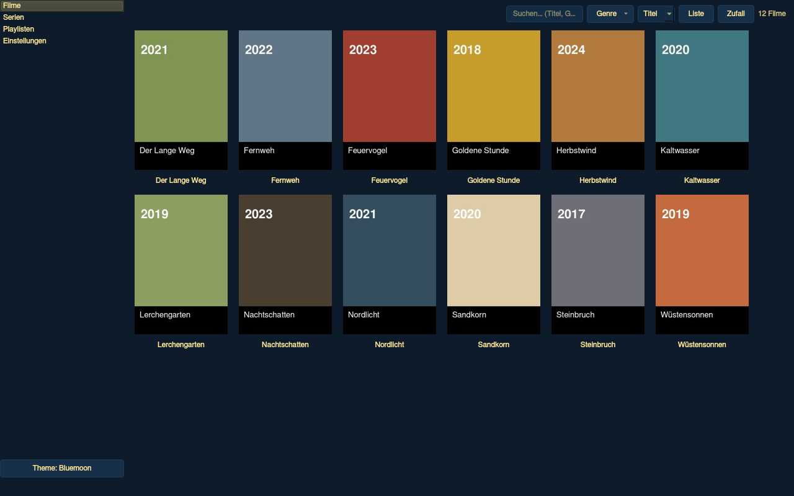
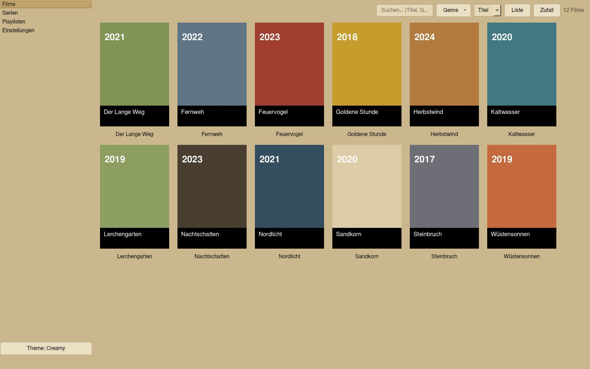

<div align="center">


# MediC

**Media library GUI for Windows &amp; Linux** — poster wall, NFO support,
playlists and playback through external players such as VLC or mpv.

**[⬇ Download (latest version)](https://github.com/cvinz78/MediC/releases/latest)** · [License: GPL-3.0](LICENSE) · [🇩🇪 Deutsch](README.md)

</div>

---

**MediC** (as in *MediaCenter*) scans local media folders, shows movies and
TV shows as a poster wall and hands playback to the external player of your
choice (default: VLC). Existing metadata and image files — `movie.nfo`,
`tvshow.nfo`, posters, fanart, trailers, subtitles — are used without any
conversion. MediC **never modifies or deletes any files in your media
library**; the app writes exclusively to its own data folder.

---

## Screenshots — the three skins

| Darkskin (default) | Bluemoon | Creamy |
|---|---|---|
|  |  |  |

The skin can be switched at any time — via the **theme button at the bottom left**
(cycles through all three) or under **Settings → View**. The change takes effect
immediately, without a restart. *(Screenshots show a sample database.)*

---

## Features

### Libraries & scanning
- **Multiple libraries** configurable (name, type, path) — any number of subfolders, recursively
- **Custom categories** next to "Movies" and "TV Shows" (e.g. "Documentary", "Comedy") — each category gets its own entry in the navigation
- **Auto-classification**: folders with a show structure (`tvshow.nfo`, `SxxEyy`) automatically land in the TV view — even inside movie/category libraries
- **Incremental scan**: unchanged entries (mtime + path) are not re-parsed
- Scanning runs in a **background thread** with progress in percent, current file and a **cancel button**
- **Network mounts** (NFS/SMB): slow scans are no problem; I/O errors (mount gone) are treated as a warning instead of aborting the scan
- Missing files are cleaned up by the scan — **from the database only, never from disk**

### NFO metadata & file detection
- NFO parsing: `movie.nfo`, `tvshow.nfo`, episode NFOs — including UTF-8 with BOM, latin-1 fallback, XML starting at any line, duplicate `<movie>` blocks, modern `<ratings>` format; unknown tags are ignored
- Detected: title, sort title, plot, year, rating, runtime, genres, studio, director, actors, poster, fanart, trailer, season/episode/airdate
- Poster/fanart/banner/season poster/trailer/subtitles follow the common NFO scheme (table below)

### Poster wall & views
- **Click a poster = the movie starts** in the default player
- **Right-click = context menu**: play, play trailer, details/media info, add to playlist, open folder, re-read metadata, remove from library
- **Poster wall ↔ list** toggle (movies, TV shows and custom categories; TV list with title/year/rating)
- **4 poster sizes** (small/medium/large/very large), title under the poster on/off
- **Live search** across title, genre and year — including year ranges (`1977-2005`, `1977-`, `-2005`)
- **Genre filter with counters** — separate per view (the movies page only shows movie genres, etc.), as a click menu with **identical behaviour on Windows & Linux**
- **Sorting** by title or year
- **"Random" button**: plays a random movie or a random episode — with an active filter from the filtered entries; in the season/episode view from the currently opened show/season

### TV view (3 levels)
- Level 1: poster wall of all shows → level 2: seasons + show info (fanart background) → level 3: episode list with thumbnails
- **Breadcrumb navigation** (Shows › Show › Season) plus **back/forward buttons** like in a browser — `Esc` steps back through the history
- Play entire shows or individual seasons (temporary M3U8 handed to the player) or add them to playlists

### Detail dialog (media info)
- Large poster, dimmed fanart as background, star rating
- Year, rating, runtime, genres, studio, director, actors, full plot
- "Files" section: video path, detected subtitles (**clickable** → playback with that subtitle), trailer source

### Playback & players
- **Default player: VLC** — automatic detection on Linux (`$PATH` → `/usr/bin` → `/usr/local/bin` → `/snap/bin` → Flatpak) and Windows (`$PATH` → Registry → program folders)
- Additional players freely configurable (mpv, SMPlayer, Celluloid …) with the argument templates `{file}` and `{subtitle}`
- **Fullscreen** optional (setting, default: off)
- **Subtitles** are passed to VLC/mpv via `--sub-file`
- **Trailers**: a local trailer file takes precedence; a YouTube URL opens in the browser (or VLC, configurable)
- Player not found → dialog with a path input instead of a silent failure
- The player starts as its own process — the app stays responsive

### Playlists
- Dedicated view: create/rename/delete playlists, reorder entries with **↑/↓**
- Entries: **movies, episodes, entire shows and seasons** (duplicates allowed)
- **Export as M3U8 / M3U / XSPF**, import of M3U/M3U8
- Playback via a temporary M3U8 handed to the player

### Keyboard shortcuts
All main actions are **editable** (Settings → Shortcuts, with collision detection
and "Reset all"). Default assignments:

| Action | Key |
|---|---|
| Play | `Enter` |
| Details/media info | `i` |
| Play trailer | `t` |
| Focus search | `Ctrl+F` |
| Scan libraries | `F5` |
| Back (dialog/level) | `Esc` |
| Remove entry from playlist | `Del` |

### Thumbnails without NFO/poster
- Without NFO/poster, a **frame from the video itself** serves as the poster (requires `ffmpeg`, detected automatically — optional)
- The **file name becomes the title** (including year detection)
- Without ffmpeg: a rendered placeholder in the skin's colour scheme
- Thumbnail cache in the data folder — even very large libraries (1000+) stay fast, the view loads lazily

### More details
- **3 skins**: Darkskin, Bluemoon, Creamy (see screenshots above)
- **Language German/English** (Settings → View; default German, applied after a restart)
- **Window size/position/maximized state is remembered**
- "Open folder" via `xdg-open` (Linux) or Windows Explorer
- **Scrollbar colours per skin**: the handle is always visible in the skin's text colour
- Missing video files are shown/flagged; permission errors (NTFS/external drives) never abort the scan
- Large/oversized image files are downscaled for rendering; truncated images are displayed as far as possible

---

## Download & installation

Ready-made builds are available in the
**[Releases](https://github.com/cvinz78/MediC/releases/latest)**:

| File | Platform | What it is |
|---|---|---|
| `MediC-windows-x64.exe` | Windows 10/11 (x64) | **Installer — contains both variants in one file:** at launch you choose **"Install"** (program folder, Start-menu shortcut, entry under "Apps & features" with an uninstaller) or **"Extract portable"** (program folder without shortcuts/registry — ideal e.g. for a USB stick). The app executable is then called `MediaCenterx64.exe` |
| `MediC-linux-x64` | Linux (x64) | A single executable file — no Python/pip needed, just a desktop with VLC/mpv |
| `MediC-windows-win7-x64.exe` | Windows 7 SP1/8.1 | Single EXE for older Windows systems (PyQt5/Qt 5.15) — OneFile, no `_internal` folder required |

> **Windows without installation:** If you don't want to install anything, run the
> `MediC-windows-x64.exe` and choose **"Extract portable"** — the installer then
> copies just the program folder to a directory of your choice. Launch it via the
> `MediaCenterx64.exe` in that folder; uninstalling = deleting the folder.

**SHA-256 (version 2.7):**

```
89631b98817b81f06844071a572dfa606860daf4e57586da33a3499bfbdee34b  MediC-windows-x64.exe
6bf4809a84c2a5e57120112a9cca3a853af3aa8f48d539e6c8cd50bf11a94f31  MediC-linux-x64
3ade745bd0b7a48e5a248a72a4bad389f7af2631595bb6c6ede7ad64f45fe226  MediC-windows-win7-x64.exe
```

**Notes:**
- **Windows**: the EXE is unsigned, so SmartScreen shows "More info → Run anyway" on
  first launch — that's normal for self-built PyInstaller EXEs.
- **Linux**: `chmod +x MediC-linux-x64` and run it. The application extracts
  **once** to `/tmp/MediaCenter/<version>` (smart cache) and then starts
  immediately from there; nothing is deleted on exit, re-extraction only happens
  when the folder was emptied or an older version is present. When launched from a
  terminal, the prompt returns immediately — the app runs detached (no log lines in
  the terminal); the log lives in `~/.medi/logs/mediacenter.log`.
- **Windows 7 SP1/8.1**: Qt 6 doesn't run there — that's what the separate
  `MediC-windows-win7-x64.exe` (PyQt5/Qt 5.15, built with Python 3.8.10) is for.
  Just run it, no installation.

---

## Build it yourself

The complete source code of the app is in this repository — the application is
deliberately **a single Python file**. Building all three variants needs exactly
this set:

| File | Purpose |
|---|---|
| `mediacenter.py` | the complete app as a single file (source for Windows; also runs directly via `python mediacenter.py`) |
| `installer.py` | Windows installer (offers "Install" and "Extract portable") |
| `build_windows.bat` | complete build of the Windows 10/11 installer |
| `build_windows_win7.bat` | build for Windows 7 SP1/8.1 (PyQt5) |
| `build_linux.bat` | builds ONLY the Linux variant (needs Docker, also runs on Windows) |
| `build_all.bat` | builds all three variants in sequence + combined `sha.txt` |
| `requirements.txt` | runtime dependencies (PySide6, Pillow) |
| `icon/mediacenter.png` + `icon/mediacenter.ico` | app icon (build + runtime) |
| `linux-version/mediacenter.py` | Linux variant of the source code (platform-specific adjustments) |
| `linux-version/launcher_stub.py` | smart-cache launcher (extracts once to `/tmp/MediaCenter/<version>`) |
| `linux-version/build_linux_docker.sh` | build script for the Docker container |
| `build_app.sh` | build script for Linux (Docker with local-venv fallback) |
| `scripts/make_ico.py` | generates the `.ico` from the PNG |
| `scripts/win7_version.txt` | version resource for the Win7 EXE |
| `scripts/write_sha.py` | writes `dist/sha.txt` + `linux-version/sha.txt` (SHA-256, full) |

| Target | Command | Result | Environment |
|---|---|---|---|
| Windows 10/11 | `build_windows.bat` | `dist\mediacenter-installer.exe` | Windows, Python 3.10+ |
| Windows 7 SP1/8.1 | `build_windows_win7.bat` | `dist\MediaCenter.exe` | Windows, Python 3.8.10 |
| Linux | `./build_app.sh` (alternatively on Windows: `build_linux.bat`) | `dist/MediaCenter` | Linux, Docker (fallback: local venv) |
| All three | `build_all.bat` | all three artifacts + `dist\sha.txt` | Windows + Docker |

`build_app.sh` automatically uses Docker (`python:3.12-slim`) so the result runs
on common distributions — without Docker it falls back to a local venv. If you
prefer not to use the script, you can feed the container directly:
`docker run --rm -v <repo>/linux-version:/app:ro -v <repo>/icon:/icon:ro -v <repo>/dist:/out python:3.12-slim bash /app/build_linux_docker.sh`.

The `.bat` scripts create their own venvs and install all dependencies
(PySide6/PyQt5, Pillow, PyInstaller). The Linux build deliberately runs in a
container (`python:3.12-slim`) so the result runs on common distributions —
PyInstaller cannot cross-compile, which is why the Windows EXE is built on
Windows and the Linux ELF on Linux/Docker. After building,
`python3 scripts/write_sha.py` writes the `sha.txt` with all hashes.

### Running directly from source (without building)

```bash
pip install -r requirements.txt     # PySide6, Pillow
python3 mediacenter.py              # on Windows: python mediacenter.py
```

Requires Python 3.10+ and an installed player (VLC recommended); optionally
`ffmpeg` for video thumbnails. On minimal Linux systems additionally
`libgl1 libegl1 libxkbcommon0 libglib2.0-0 libdbus-1-3 libfontconfig1`.

---

## Getting started

1. Launch → **Settings → Libraries → Add**: choose a folder (e.g. `~/Movies`,
   `/mnt/nas/Shows`), set name and type (movies/TV/**custom category**).
2. The scan runs in the background (progress + cancel) — afterwards the
   **poster wall** appears.
3. **Click** = play, **right-click** = context menu, **F5** = rescan.
4. Without NFO/poster, MediC automatically shows video-frame thumbnails (with
   ffmpeg) and file-name titles — every detected video file appears in the view.

---

## Network shares: deliberately local libraries only

MediC **deliberately does not support network protocols** (no SMB, NFS,
DLNA/UPnP — neither when scanning nor when playing). Reason: a media library GUI
that itself reads and plays over the network would also require the external
media player (VLC, mpv …) to support the same protocol — that makes the app
dependent on the player and troubleshooting unreliable. MediC therefore works
exclusively with **local folder paths**.

**Network sources still work** — via the operating system: mount the share once
in Windows or Linux, and use the mounted folder as an ordinary library:

| Platform | Mount the share | Example library path |
|---|---|---|
| Windows | Explorer → "Map network drive" (or `net use Z: \\NAS\Movies /persistent:yes`) | `Z:\Movies` |
| Linux | `mount` SMB/NFS, e.g. `sudo mount -t cifs //NAS/Movies /mnt/movies` (or fstab/autofs) | `/mnt/movies` |

To MediC a mounted network share is just an ordinary local folder: the scan
reads the files through the file system, and playback starts the player with the
path — **the networking is handled by the operating system or the player, not
MediC**. Scans over slow mounts (NFS/SMB) remain usable thanks to the progress
display and cancel button; I/O errors (mount unreachable) never abort the scan
but are treated as warnings.

---

## Detection rules

| Type | What is looked for (order = priority) |
|---|---|
| Video | `.mkv .mp4 .avi .m2ts .iso .wmv .mov .webm .ts .mpg .mpeg .flv` and more (case-insensitive) |
| Movie NFO | `movie.nfo`, `<videoname>.nfo` in the same folder |
| Show NFO | `tvshow.nfo` in the show folder; episodes: `s01e02.nfo`/`<name>.nfo` |
| Poster | `poster.jpg` › `folder.jpg` › `cover.jpg` › `<name>.jpg` › `<foldername>.jpg` |
| Season poster | `season01-poster.jpg`, `Season 01/poster.jpg`, `staffel1-poster.*` … |
| Fanart/banner | `fanart.jpg`, `banner.jpg` |
| Trailer | `trailer.mp4/mkv/mov` › `<name>-trailer.*` › folder `trailer(s)/` › `<trailer>` URL from the NFO |
| Subtitles | `<name>.srt/.ass/.sub/.vtt` (also in the `subs/` folder) |
| Episodes | `Show/Season 01/S01E02.mkv` (also `1x02`, fallback: order) |

---

## Data folder

All settings, the database and the logs live outside the media library:

| Platform | Folder |
|---|---|
| Linux | `~/.medi/` (`config/settings.json`, `data/library.db`, `data/cache/`, `logs/`) |
| Windows | `%USERPROFILE%\.medi\` |

The environment variable `MEDIACENTER_DATA_DIR` lets you relocate the folder
freely (e.g. portable on the media drive). Log for troubleshooting:
`~/.medi/logs/mediacenter.log` or `%USERPROFILE%\.medi\logs\mediacenter.log`.

---

## License

Copyright © 2026 cvinz78

This program is free software: you can redistribute it and/or modify it under
the terms of the **GNU General Public License, version 3** as published by the
Free Software Foundation. See [LICENSE](LICENSE) for details.

This program is distributed in the hope that it will be useful, but **without
any warranty** — without even the implied warranty of merchantability or fitness
for a particular purpose. See the GNU GPL version 3 for details.
